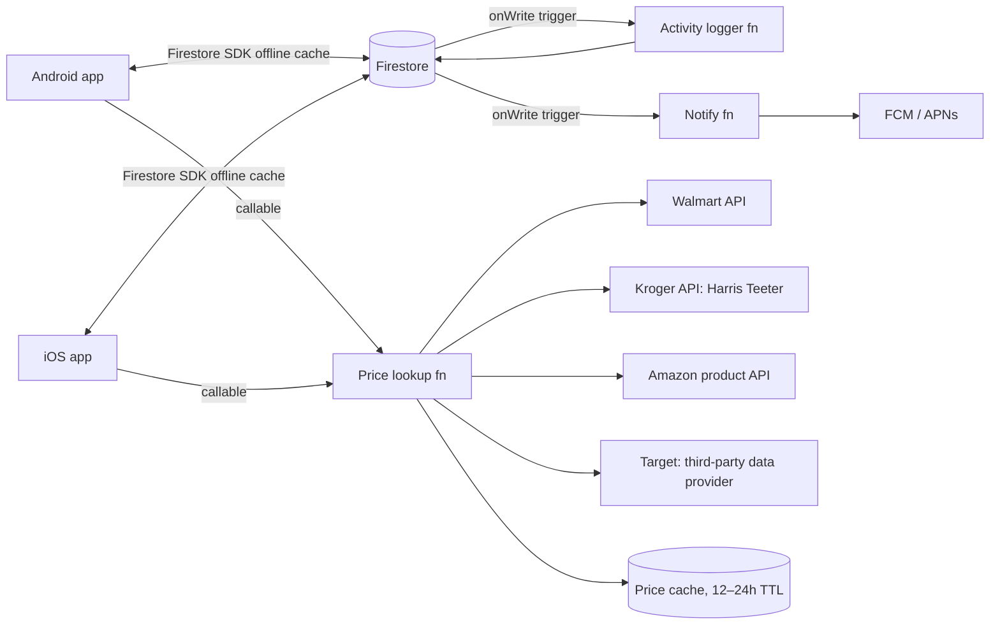

# Fridgeboard: Discovery Plan

> **Phase:** Discovery · **Date:** 2026-11-01 · **Owners:** you + girlfriend (the only two users, and the product team)
> **Working name:** Fridgeboard. Rename it whenever you like.

---

## 1. Problem statement

The grocery list lives on a whiteboard on the fridge. That works at home and stops working everywhere else:

- You can't see it at Target or Walmart unless someone took a photo.
- Neither of you knows what the other added, or when.
- Nothing connects the list to stores, prices, or delivery carts.
- "Need now" and "would be nice" are mixed together, or the second kind never gets written down.

**Job to be done:** *"When either of us notices we need something, we add it in seconds. When either of us is at a store, we see the right list for that store with prices and check things off, and the other person sees it happen live."*

## 2. Users and platforms

| User | Device | Notes |
| --- | --- | --- |
| You | Android | Own account |
| Girlfriend | iPhone (iOS) | Own account |

Two separate accounts, one shared **household**. The data model should still allow more members later (roommate, family) without a rewrite.

## 3. Requirements

### 3.1 Must have (MVP)

| ID | Requirement | Notes |
| --- | --- | --- |
| R1 | Native-feeling apps on Android and iOS from one codebase | See §5 |
| R2 | Separate accounts, one shared household | Invite by link or 6-digit code |
| R3 | Real-time sync, under 1 second when both phones are online | Optimistic UI |
| R4 | Works offline in the store and syncs when signal returns | Big-box stores often have weak signal |
| R5 | **Two lists: Grocery (need) and Nice-to-have** | One tap moves an item between them |
| R6 | **Activity log**: every add, edit, check-off, move, and delete records who did it and when | Multi-item adds appear as one grouped entry ("Alex added 6 items") that expands to show each item |
| R7 | Store tags per item: Walmart, Target, Harris Teeter, Amazon, or Any | Filter the list by store |
| R8 | Quantity, unit, and optional note per item | "2 × gallon, the lactose-free one" |
| R9 | Push notification options: "partner started shopping", "partner added items" (batched) | Each person can mute each one |

### 3.2 Should have (v1.x)

| ID | Requirement | Notes |
| --- | --- | --- |
| R10 | **Price lookup** for the selected store | Feasibility differs a lot by store. See §6 |
| R11 | Running estimated total per store trip | Needs R10 |
| R12 | Send list to store cart (Walmart and Amazon add-to-cart links) | No API approval needed for the basic link |
| R13 | Auto-categorize items into aisles (Produce, Dairy, Frozen…) | Rules first, then learn from your edits |
| R14 | Staples / recurring items ("milk every week") | Re-adds itself to Grocery on a schedule |

### 3.3 Explicitly out of scope for MVP

Payments, checkout inside the app, coupon clipping, social or public sharing, web app (possible later).

## 4. Industry-standard features to plan for (future roadmap)

These are features that leading list apps (AnyList, OurGroceries, Bring!, Instacart, Walmart and Target's own apps) have made standard. Ranked by value to a two-person household:

| Priority | Feature | Why it matters |
| --- | --- | --- |
| ★★★ | **Store mode**: large check-off targets, sorted by aisle, screen stays on, checked items drop to the bottom | The single biggest in-store usability gain |
| ★★★ | **Quick add**: autocomplete from your history, voice ("Hey Google / Siri, add eggs to Fridgeboard"), home-screen widget | Adding has to be faster than walking to the whiteboard |
| ★★★ | **Smart suggestions**: "You usually buy bananas every 6 days" | Built from your own purchase history |
| ★★ | **Barcode scan to add**: scan the empty box before it goes in the recycling | Also returns the exact product for pricing |
| ★★ | **Price history and budget**: monthly grocery spend, per-store comparison, "cheapest store for this trip" | Needs price data (§6) plus check-off events |
| ★★ | **Recipes to list**: paste a recipe URL and it pulls out the ingredients | Many sites publish structured recipe data (schema.org/Recipe) |
| ★★ | **Meal planner**: a week view that feeds the Grocery list | Natural next step after recipes |
| ★★ | **Receipt scan**: OCR the receipt to log actual prices and close out the trip | Real prices without any store API |
| ★ | **Pantry inventory**: what's at home, with expiry reminders | Useful but high upkeep. Many people stop using it |
| ★ | **Live Activity (iOS) / ongoing notification (Android)** showing a partner's trip in progress | "Sam is at Target: 7 of 12" |
| ★ | **Watch apps** (Apple Watch / Wear OS) | Check off with your hands full |
| ★ | **Deals / weekly ad** surfacing for tagged items | Data is hard to get. See §6 |
| ★ | **Web app** for planning from a laptop | Same backend, cheap to add later |

## 5. Recommended architecture

### 5.1 Decision summary

| Layer | Recommendation | Alternatives considered |
| --- | --- | --- |
| Mobile | **Expo (React Native) + TypeScript** | Flutter (also strong), separate native apps (twice the work) |
| Sync and data | **Firebase Cloud Firestore** with offline persistence | Supabase (Postgres + Realtime). Better for SQL and reporting, but needs PowerSync or similar for real offline support |
| Auth | Firebase Auth: **Sign in with Apple** + Google | Apple requires Sign in with Apple if you offer Google sign-in on iOS |
| Server logic | Cloud Functions (TypeScript): price lookups, notifications, staples scheduler | Supabase Edge Functions |
| Push | Firebase Cloud Messaging (APNs on iOS) via `expo-notifications` | OneSignal |
| Distribution | iOS: **TestFlight** (needs Apple Developer Program, $99/yr). Android: Play internal testing ($25 one-time) or install the APK directly | Expo dev builds during development |

**Why this stack:** one TypeScript codebase for both phones. Offline-first sync comes built in, which matters most in a store with no signal. The cost for two people is $0 on Firebase's free tier. Supabase is the right pick if you later want heavy analytics on spending. The data model below maps cleanly to either.

### 5.2 Data model (initial)

```text
households/{householdId}
  name, createdAt, memberIds[], inviteCode
  stores: [walmart, target, harris_teeter, amazon]  // enabled stores + preferred location IDs

households/{householdId}/items/{itemId}
  name, normalizedName, list: "grocery" | "nice_to_have"
  qty, unit, note, category, storeTags[], preferredStore
  status: "open" | "checked" | "deleted"
  productRefs: { walmart?: itemId, target?: tcin, kroger?: productId, amazon?: asin }
  lastPrice: { [store]: { cents, fetchedAt, source } }
  createdBy, createdAt, updatedBy, updatedAt, version

households/{householdId}/activity/{eventId}        // append-only, written by Cloud Function trigger
  actorId, type: "add" | "edit" | "check" | "uncheck" | "move" | "delete" | "trip_start" | "trip_end"
  itemIds[], batchId?, diff?, at

households/{householdId}/trips/{tripId}
  store, startedBy, startedAt, endedAt, checkedItemIds[], estTotalCents, actualTotalCents?

users/{uid}
  displayName, color, householdId, notificationPrefs, fcmTokens[]
```

**Activity log rules:** the client never writes to `activity` directly. A Firestore trigger writes the events, so the log can't be faked or skipped. Adds from the same person within 60 seconds get the same `batchId`, so the feed can show "added 6 items" as one entry.

**Conflicts:** last write wins per field, using `version` to detect a stale edit. Check-off is idempotent. If you both check off milk, nothing breaks.

**Security rules:** a user can read and write only inside the household that lists them in `memberIds`.

### 5.3 System sketch



## 6. Store pricing and cart feasibility

This section determines whether pricing ships in v1.x or later. **Every row needs a short technical spike before you commit to it**, because retailer API terms change often.

| Store | Product / price data | Cart handoff | Feasibility | Notes |
| --- | --- | --- | --- | --- |
| **Walmart** | Walmart affiliate API (walmart.io): search, item lookup, price | Affiliate add-to-cart URL with item IDs and quantities | 🟢 Good | Needs an affiliate application. Prices are online prices and can differ from your local store |
| **Harris Teeter** | Harris Teeter is owned by **Kroger**. Kroger's public Developer API (developer.kroger.com) has Products and Locations endpoints with location-specific prices | Kroger API has a cart endpoint for Kroger-banner accounts | 🟡 Probable | **Spike first:** confirm Harris Teeter locations show up in the Kroger Locations API. If they don't, fall back to receipt scan or manual price entry |
| **Amazon** | Amazon's Associates product API (PA-API 5.0 or its successor) | Public "add to cart" URL with ASINs and quantities | 🟡 Gated | API access requires an Associates account with recent qualifying sales. The cart URL works without API access |
| **Target** | **No public API.** Options: a paid third-party data provider (e.g. RedCircle API), or scraping (against ToS, breaks often, **not recommended**) | Deep link to the product page only | 🔴 Limited | Plan for manual or receipt-based prices, or budget about $15–50/mo for a provider |
| Any store | **Receipt OCR** (on-device ML Kit / Vision, or a cloud OCR API) | n/a | 🟢 Always works | Gives the prices you actually paid. Strong fallback that works for every store |

**Recommended pricing strategy:**

1. v1.0: manual "last paid" price on each item, filled in by receipt scan where possible.
2. v1.1: Walmart API + Kroger/Harris Teeter API live lookups, cached 12–24h.
3. v1.2: Amazon API if eligible. Target through a provider if the price is worth it.
4. Always show **where a price came from and how old it is** ("Walmart.com · 3h ago"), because online and in-store prices differ.

**Item to product matching** is the hard part. "Milk" is not a product. Flow: when you set a preferred store, the app shows the top 3 product matches. You pick one once, and the choice is saved in `productRefs`. Barcode scanning skips this step entirely.

## 7. Design concepts

Four layout directions are in [`design-concepts.html`](design-concepts.html), each with a phone mockup, a description of the main interaction, and trade-offs.

| # | Concept | Organizing idea | Best for |
| --- | --- | --- | --- |
| A | **Fridge Board** | Digital version of the whiteboard: freeform, handwritten feel, each person has a marker color | Smallest change from your current habit |
| B | **Aisle Flow** | Store mode first: grouped by aisle, big check targets, store switcher | Fastest shopping trips |
| C | **Price Board** | Item × store price grid with the cheapest store highlighted, splits the list into per-store carts | Saving money across 4 stores |
| D | **Together Feed** | Activity timeline is the home screen: who added what, reactions, nice-to-have as a swipe deck | Coordinating with each other, the activity log |

**Principal-engineer recommendation:** ship **B (Aisle Flow) as the main screen**, with **D's activity feed as a second tab** and **C's price grid as a "Compare" sheet** that slides up from B. Borrow A's per-person colors everywhere so it's always clear who added what. You don't need to choose one concept. They work as layers of one app.

## 8. Roadmap

| Phase | Scope | Exit criteria |
| --- | --- | --- |
| **0. Discovery** (now) | This plan, answer open questions, pick a concept, run the Kroger/HT and Walmart API spikes | Decisions logged in §10 |
| **1. MVP** (~3–4 weekends) | R1–R9: accounts, household invite, two lists, store tags, real-time + offline sync, activity log, push | Both phones replace the whiteboard for 2 weeks without anyone going back to it |
| **2. Store smarts** | R10–R14: prices (Walmart, HT), totals, cart handoff, auto-categories, staples | Estimated total within ~10% of the receipt |
| **3. Delight** | Widgets, voice add, barcode, receipt scan, suggestions | Adding an item takes under 3 seconds |
| **4. Planning** | Recipes, meal plan, budget/spend history, web app | Optional |

## 9. Risks

| Risk | Impact | Mitigation |
| --- | --- | --- |
| Retailer API access denied or changed | No live prices | Receipt scan + manual prices, so the app is fully useful without APIs |
| Online prices ≠ in-store prices | Wrong totals | Show source and age on every price. Let receipt prices override |
| Apple review / developer cost | Delays her install | TestFlight builds don't need App Store review for internal testers |
| Sync conflicts | Duplicate or lost items | Firestore transactions, normalized-name dedupe ("Eggs" vs "eggs") |
| Scope creep | Never ships | Hold the MVP line in §3.1 |

## 10. Open questions (answers will tailor the design)

**Behavior**

1. **Activity logging.** I read "if any of us add more than one item, it is logged" as: *log every change, and group a multi-item add into one feed entry.* Is that right? Or did you mean only multi-item adds should be logged, or that duplicate adds of the same item should be flagged?
2. Should checked-off items stay visible (crossed out) until the trip ends, or disappear right away?
3. Do you usually shop **together** or **split up** (one at Target, one at Walmart)? This decides how much the per-store split view matters.
4. When an item is on Nice-to-have, what moves it to Grocery: a manual tap, a price drop, or "we're at that store anyway"?

**Stores**

5. Do you have Walmart+, Target Circle, Amazon Prime/Fresh, or Harris Teeter VIC accounts? Cart handoff and pricing work best with these.
6. Do you mostly shop **in store**, **pickup**, or **delivery** at each one?
7. Which Walmart, Target, and Harris Teeter **locations** (zip code is enough)? Prices are location-specific.
8. Is paying ~$15–50/month for Target price data worth it to you, or are receipt-based prices fine?

**Look and feel**

9. Which concept (A–D) feels most like you two? Mixing them is fine.
10. Dark mode, light mode, or follow the phone?
11. Any must-have personal touches: your own colors, avatars, a house name, inside-joke categories?

**Logistics**

12. Will you build this yourself (and in which language are you most comfortable), or should the plan assume Claude/Copilot write most of it?
13. Are you OK paying $99/yr for the Apple Developer Program so she can install through TestFlight?
