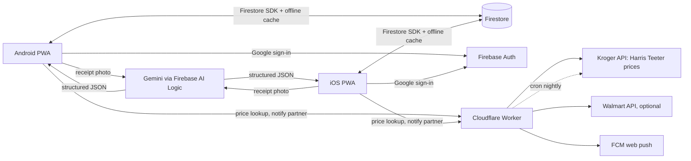

# Fridgeboard: Discovery Plan

> **Phase:** Discovery · **Revised:** 2026-11-01 (v2) · **Owners:** you + girlfriend (the only two users, and the product team)
> **Working name:** Fridgeboard. Rename it whenever you like.

**What changed in v2:** switched to an installable **PWA** (no app stores). **Google sign-in** through Firebase. A **$0 stack that needs no credit card**. A new **receipts and spending** feature. Store plans tailored to how you shop. Target pricing options researched.

---

## 1. Problem statement

The grocery list lives on a whiteboard on the fridge. That works at home and stops working everywhere else:

- You can't see it at Target or Harris Teeter unless someone took a photo.
- Neither of you knows what the other added, or when.
- Nothing connects the list to stores, prices, carts, or what you actually spend.
- "Need now" and "would be nice" are mixed together, or the second kind never gets written down.

**Job to be done:** *"When either of us notices we need something, we add it in seconds. When we shop, together or alone, we see the right list for that store and check things off live. Afterward we snap the receipt and know what we spent."*

## 2. Your household profile

| Topic | Answer | What it means for the design |
| --- | --- | --- |
| Devices | Android (you), iPhone (her) | One PWA installed on both home screens |
| Sign-in | Google | Firebase Auth, Google provider |
| How you shop | Usually **together**, sometimes **solo** | Shared live trip (both phones see check-offs) plus a solo trip that notifies the other person |
| **Target** | **Order pickup**, Target Circle member | Target is a *build list → place order in Target app → pick up* flow, not an aisle walk |
| **Harris Teeter** | **In store**, VIC card | Full in-store mode: sorted by aisle, check-off, VIC price estimate |
| **Amazon** | Prime | Add-to-cart link handoff. Prices mainly from order history |
| **Walmart** | Not answered yet | Kept as a store option. Its API is the easiest of the four, if you use it |
| Location | **28262** (Charlotte, University City area) | Default zip code for store lookup. The nearest Target and Harris Teeter are chosen once in Settings |
| Budget | **Free** | Everything in §5 runs at $0 with no billing account |

## 3. Requirements

### 3.1 Must have (MVP)

| ID | Requirement | Notes |
| --- | --- | --- |
| R1 | **Installable PWA** for Android (Chrome) and iOS (Safari, "Add to Home Screen") | Opens full screen, has its own icon, works offline |
| R2 | **Google sign-in**, separate accounts, one shared household | Invite your partner by link or 6-digit code |
| R3 | Real-time sync, under 1 second when both phones are online | Firestore listeners, optimistic UI |
| R4 | Works offline in the store and syncs when signal returns | Firestore's offline cache (IndexedDB) |
| R5 | **Two lists: Grocery (need) and Nice-to-have** | One tap moves an item between them |
| R6 | **Activity log**: every add, edit, check-off, move, and delete records who did it and when | Multi-item adds appear as one grouped entry that expands to show each item |
| R7 | Store tags per item: Target, Harris Teeter, Amazon, Walmart, or Any | Filter the list by store |
| R8 | Quantity, unit, and optional note per item | "2 × gallon, the lactose-free one" |
| R9 | **Trips**: *Shop together* (shared live check-off) and *Shopping solo* (partner gets a notification) | See §6 |

### 3.2 Should have (v1.x)

| ID | Requirement | Notes |
| --- | --- | --- |
| R10 | **Receipt upload and catalog** | Photo or screenshot → parsed items, prices, tax, total. See §7 |
| R11 | **Spending dashboard** | By month, store, category, and person. Price history per item |
| R12 | **Price display** for each store | Harris Teeter: live from the Kroger API. Target and Amazon: last price you paid, from receipts. See §8 |
| R13 | Target pickup helper | Opens each item in the Target app. Marks the order as placed and then picked up |
| R14 | Amazon cart handoff | Public add-to-cart URL with your saved ASINs |
| R15 | Auto-categorize into aisles, plus staples / recurring items | Rules first, then learn from your edits |
| R16 | Push notifications | Android Chrome: yes. iOS: only for the installed home-screen app on iOS 16.4+ |

### 3.3 Out of scope for MVP

Payments, checkout inside the app, coupon clipping, Apple Watch / Wear OS, native widgets (PWAs can't make them).

## 4. Industry-standard roadmap (adjusted for a PWA)

| Priority | Feature | PWA notes |
| --- | --- | --- |
| ★★★ | **Store mode** for Harris Teeter: aisle sort, big check targets, screen stays on | Wake Lock API works on both platforms |
| ★★★ | **Quick add** with autocomplete from your history | Works fully |
| ★★★ | **Receipts → spending** (now core, see §7) | Camera through file input works on both |
| ★★ | **Smart suggestions**: "You buy bananas about every 6 days" | Built from receipt history |
| ★★ | **Barcode scan to add** | Use the `zxing` JS library. iOS Safari has no built-in BarcodeDetector |
| ★★ | **Voice add** | Android: Google Assistant can open a URL. iOS: a Siri **Shortcut** that posts to the app's add endpoint ("Hey Siri, add to Fridgeboard") |
| ★★ | **Budgets** with a monthly limit and alerts at 80% | From receipt totals |
| ★★ | **Recipes to list** (paste a URL, ingredients are extracted) | Recipe sites publish structured data (schema.org/Recipe) |
| ★ | Meal planner | Feeds the Grocery list |
| ★ | Pantry inventory with expiry reminders | High upkeep, so optional |
| ✗ | Home-screen widgets, Live Activities, watch apps | **Not possible as a PWA.** This is the main thing the PWA choice costs you |

## 5. Architecture: free, PWA, Firebase

### 5.1 The $0 stack (no credit card required)

| Layer | Choice | Free-tier limits (more than enough for 2 people) |
| --- | --- | --- |
| App | **Vite + React + TypeScript** with `vite-plugin-pwa` (Workbox service worker, web manifest) | n/a |
| Hosting | **Firebase Hosting** at `fridgeboard.web.app` (free subdomain, HTTPS) | 10 GB stored, ~360 MB/day transfer |
| Sign-in | **Firebase Auth, Google provider** | Free for Google sign-in |
| Database and sync | **Cloud Firestore** with `persistentLocalCache` (offline support) | 1 GiB stored, 50k reads and 20k writes per day |
| Small server (secrets, price lookups, push sends) | **Cloudflare Workers** free plan | 100k requests/day, cron triggers included, no card |
| Receipt reading | **Gemini through Firebase AI Logic** (Gemini Developer API free tier), with on-device **Tesseract.js** as a private fallback | Free tier has rate limits. See the privacy note in §7.4 |
| Receipt images | Compressed WebP (~150–250 KB) stored **in Firestore** | About 4,000 receipts fit in the free 1 GiB |
| Push | Firebase Cloud Messaging web push, sent from the Worker | Free |
| Code | GitHub (this repo), Prettier for formatting | Free |

**Why not Cloud Functions or Cloud Storage?** Both now require Firebase's pay-as-you-go **Blaze** plan, which needs a credit card. At your usage Blaze would very likely still cost $0, and you can set a $1 budget alert. If you'd rather keep it simpler, switching later is easy: the Worker code moves into Functions and images move into Storage. For now the plan stays on the free **Spark** plan, as you asked.

### 5.2 Google sign-in on an installed PWA (important detail)

Google sign-in from a home-screen app on an iPhone is the most common place PWAs break. To avoid that:

1. Host on **Firebase Hosting** and set `authDomain` to the same domain the app runs on (`fridgeboard.web.app`). The sign-in handler (`/__/auth/handler`) is then served from the app's own domain, which avoids Safari's cross-site storage blocking.
2. Use `signInWithRedirect` in standalone mode and `signInWithPopup` in a normal browser tab.
3. Sign in **inside the installed app**, not in Safari first. On iOS, a home-screen app has storage separate from Safari.
4. Security rules allow access only to the two Google accounts listed in the household (`memberIds`). No one else can read anything, even with the URL.

### 5.3 Data model

```text
households/{hid}
  name, memberIds[], inviteCode, zip: "28262"
  stores: { target: {storeId, mode:"pickup"}, harris_teeter: {krogerLocationId, mode:"in_store"},
            amazon: {mode:"delivery"}, walmart?: {...} }
  budget: { monthlyCents, alertAtPct: 80 }

households/{hid}/items/{itemId}
  name, normalizedName, list: "grocery" | "nice_to_have"
  qty, unit, note, category, storeTags[], preferredStore
  status: "open" | "checked" | "ordered" | "deleted"        // "ordered" = in a Target pickup order
  productRefs: { target?: tcin, kroger?: productId, amazon?: asin, walmart?: itemId }
  lastPaid: { [store]: { cents, at, receiptId } }           // from receipts
  livePrice: { [store]: { regularCents, promoCents, fetchedAt, source } }
  createdBy, createdAt, updatedBy, updatedAt

households/{hid}/activity/{eventId}        // append-only
  actorId, type, itemIds[], batchId?, diff?, at

households/{hid}/trips/{tripId}
  store, mode: "together" | "solo", participants[], startedAt, endedAt,
  checkedItemIds[], estTotalCents, receiptId?

households/{hid}/receipts/{receiptId}
  store, storeLocation, purchasedAt, channel: "in_store" | "pickup" | "delivery"
  subtotalCents, taxCents, savingsCents, totalCents, paidBy (uid)
  lines: [{ rawText, name, qty, unitCents, lineCents, category, itemId?, productRef? }]
  status: "parsing" | "needs_review" | "confirmed"
  imageChunks: n                            // image stored in receiptImages/{receiptId}_{i}

users/{uid}
  displayName, photoURL (from Google), color, householdId, notificationPrefs, fcmTokens[]
```

**Activity log without a server:** on the Spark plan there are no database triggers, so the app writes each activity entry in the **same batched write** as the change itself. Security rules require `actorId == request.auth.uid` and allow **create only**: no updates and no deletes. The log can't be edited or faked, even by you.

### 5.4 System sketch



## 6. Shopping flows by store

### Harris Teeter: in store, VIC
1. Tap **Start trip → Harris Teeter → Together or Solo**.
2. The list sorts by aisle and the screen stays on. The estimated total uses the Kroger API's *promo* price where there is one (the VIC/card price, **to be confirmed in the spike**) and the regular price otherwise.
3. **Together:** both phones show the same trip. Each check-off appears on the other phone right away, with the checker's color. You can split up by aisle without texting.
4. **Solo:** your partner gets "Alex is at Harris Teeter (12 items)" and can add things while you're there. New additions flash at the top.
5. **End trip:** you're prompted to snap the receipt, and the trip closes against it.

### Target: order pickup, Target Circle
1. Filter the list to **Target**. Each item shows the last price you paid there.
2. **Build pickup order:** each item has an **Open in Target** button, which opens the product in the Target app through its product link, where Circle offers apply. Mark each item **Added** as you go.
3. **Order placed:** the items move to the *Ordered* state, so neither of you adds them again.
4. **Picked up:** snap the receipt or a screenshot of the order in the Target app. Items are checked off and the prices you actually paid are recorded.

### Amazon: Prime
- An **Send to Amazon cart** button builds one add-to-cart link from the saved ASINs of every item tagged Amazon.
- Prices come from screenshots of your Amazon orders, parsed the same way as receipts.

## 7. Receipts and spending (new)

### 7.1 Capture
- **Camera photo** of a paper receipt (Harris Teeter, Target in store).
- **Screenshot** from the Target app, Amazon orders, or emailed receipts. These are often more accurate than paper.
- Multiple photos for long receipts, stitched in order.
- Recorded as **paid by** whoever uploads it, which you can change.

### 7.2 Parse
1. The app compresses the image and sends it to Gemini with a strict output schema: store, date, items, quantities, prices, savings, tax, total.
2. **Check:** the line items must add up to the subtotal, and subtotal plus tax to the total, within a few cents. If they don't, the receipt is marked *Needs review*.
3. **Match:** each receipt line is matched to an item on your list ("HT ORG SPINACH 10Z" → *Spinach*). You confirm uncertain matches once and the app remembers them.
4. Matched items are checked off, and `lastPaid` updates with the real price.

### 7.3 Spending dashboard
- This month vs. last month, and against your budget.
- Spending by **store**, **category** (produce, dairy, household…), and **person**.
- **Price history** for each item across stores: "Oat milk: HT $3.99 with VIC, Target $4.29."
- Savings: VIC and Circle discounts recorded from the receipts.
- Export to CSV, if you ever want it in a spreadsheet.

### 7.4 Privacy note
Receipts include the store location, the last 4 digits of your card, and sometimes a member ID. Two protections:
- The app **crops off** the payment section before upload. You draw a box or tap "hide card info".
- Google's terms allow it to use data sent to the **free** Gemini tier to improve its products. If that bothers you, switch to **on-device Tesseract.js**: fully private, but less accurate, so expect to fix more lines by hand.

## 8. Store prices: what's actually possible

| Store | How you shop | Price source | Outlook |
| --- | --- | --- | --- |
| **Harris Teeter** | In store, VIC | **Kroger Developer API** (free account). Harris Teeter is a Kroger company. Products API with a `locationId` returns regular and promo prices for that store | 🟡 Probable. **Spike 1:** confirm a Harris Teeter near 28262 shows up in the Kroger Locations API |
| **Target** | Pickup, Circle | **Your own receipts and order screenshots** (free, exact, include Circle discounts) | 🟢 Reliable for "last paid" |
| | | Target's **internal website API** (what target.com itself calls, sometimes called "Redsky") can return store-specific prices | 🔴 Unofficial: undocumented, against Target's terms, and can be blocked or change at any time. I tried to test it from this session and the request was blocked. **Not recommended as something the app depends on** |
| | | Paid data providers (e.g. RedCircle API) | 🔴 Not free past a trial |
| **Amazon** | Prime | Order screenshots → receipts. The official product API needs an Associates account with recent sales | 🟡 Receipt-based |
| **Walmart** | Not answered yet | Walmart affiliate API (free, needs approval) | 🟢 If you use Walmart |

**Bottom line on Target:** there's no free, official way to get live Target prices. The best free option is "last paid" from your own pickup orders. You already get an itemized order in the Target app, and a screenshot of it gives exact prices including Circle discounts. After a month of orders, most of your regular items will have a real price. The app will show `Target · paid $3.49 on Oct 24` rather than pretending to have a live price.

## 9. Design direction

The four concepts are in [`design-concepts.html`](design-concepts.html). Updated recommendation for how you shop:

- **Home:** *Aisle Flow (B)* for Harris Teeter trips, with a **Target pickup** variant (checklist plus Open in Target buttons).
- **Second tab:** *Together Feed (D)*, the activity log and Nice-to-have swipe deck.
- **Third tab (new): Spending**, with receipts, monthly totals, and price history. It replaces the separate *Price Board (C)* screen, because prices now come mostly from receipts.
- Per-person marker colors from *Fridge Board (A)* everywhere.

## 10. Roadmap

| Phase | Scope | Exit criteria |
| --- | --- | --- |
| **0. Discovery** (now) | This plan. **Spike 1:** Kroger API + Harris Teeter near 28262. **Spike 2:** Google sign-in in an installed iOS PWA. **Spike 3:** Gemini parsing on 5 real receipts (2 HT, 2 Target, 1 Amazon) | All three spikes have an answer |
| **1. MVP** (~3–4 weekends) | R1–R9: PWA install, Google sign-in, household invite, two lists, store tags, sync, offline, activity log, trips | The whiteboard goes unused for 2 weeks |
| **2. Receipts and spending** | R10–R11: upload, parse, review, match, dashboard, budget | 90% of receipt lines parse without manual fixes |
| **3. Store smarts** | R12–R16: Harris Teeter prices, Target pickup helper, Amazon cart link, categories, staples, push | Harris Teeter estimate within ~10% of the receipt |
| **4. Delight** | Suggestions, barcode, Siri Shortcut / Assistant add, recipes | Adding an item takes under 3 seconds |

## 11. Risks

| Risk | Impact | Mitigation |
| --- | --- | --- |
| Google sign-in quirks in an iOS home-screen app | Can't sign in | Same-domain `authDomain` + redirect sign-in (§5.2), tested first in Spike 2 |
| iOS PWA push needs iOS 16.4+ and the installed app | No alerts on her phone | Fallback: an in-app banner the next time the app opens |
| Kroger API doesn't include Harris Teeter, or no VIC price | No live HT prices | Receipt-based last-paid prices, the same as Target |
| Gemini free tier changes or privacy concerns | Receipt parsing stops or feels risky | Tesseract.js fallback. Parsing sits behind one interface, so the engine can be swapped |
| Free-tier limits | Writes fail | 20k writes/day is about 100× what two people use |
| iOS deletes site data for an unused PWA | Local cache lost | Firestore is the real copy. The cache refills on next open |

## 12. Open questions (remaining)

1. **Logging:** confirm the interpretation: every change is logged, and multi-item adds are grouped into one entry.
2. **Walmart:** do you still shop there? If not, it's removed from the MVP.
3. Should checked-off items stay visible (crossed out) until the trip ends, or disappear right away?
4. **Monthly grocery budget** to track against, if you want one.
5. **Receipt parsing:** OK with Gemini's free tier (most accurate) with card info cropped out, or do you prefer the fully private on-device option?
6. What's her iPhone's iOS version? It needs 16.4+ for push notifications.
7. Who's building it? You with Copilot, or mostly Claude? This decides how much detail the implementation plan needs.
8. App name: keep *Fridgeboard*, or something else?

### Answered in v2
- Platform: **PWA + Firebase + Google sign-in** · Shopping: **mostly together, sometimes solo** · Target: **pickup, Circle** · Harris Teeter: **in store, VIC** · Amazon: **Prime** · Zip: **28262** · Budget: **free** · New feature: **receipts and spending**
